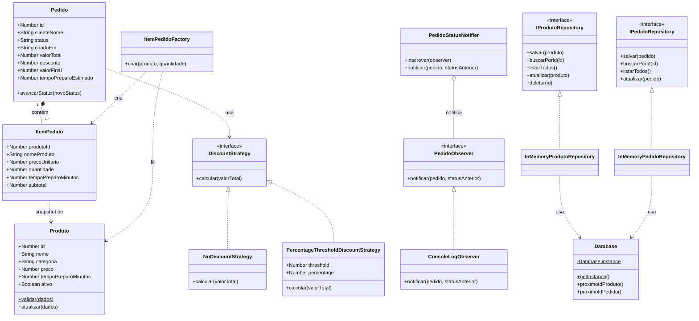
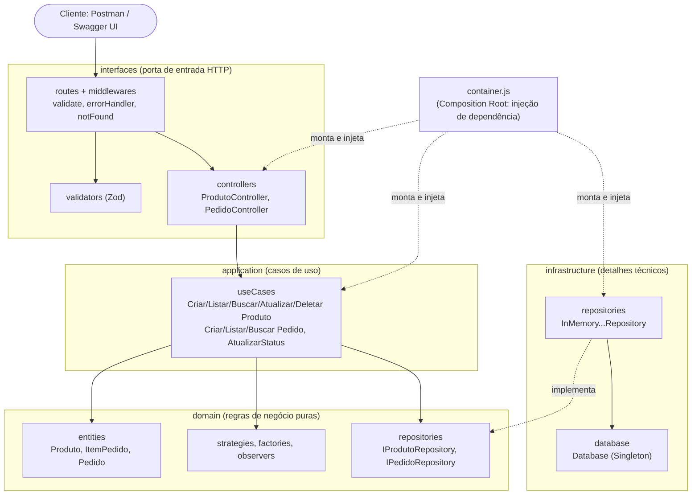

# Diagramas do Projeto

## 1. Diagrama de Classes (domínio e padrões)

## 2. Diagrama de Arquitetura (camadas / pacotes)

**Regra de dependência:** as setas apontam sempre para dentro. O `domain` não conhece `application`, `interfaces` nem `infrastructure`. A infraestrutura só aparece ligada ao domínio pela seta pontilhada "implementa".